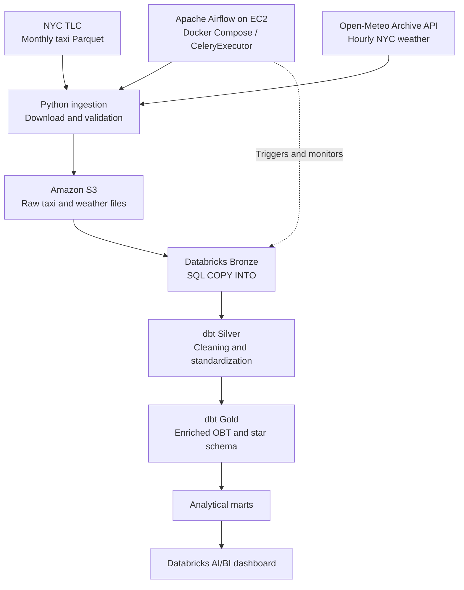
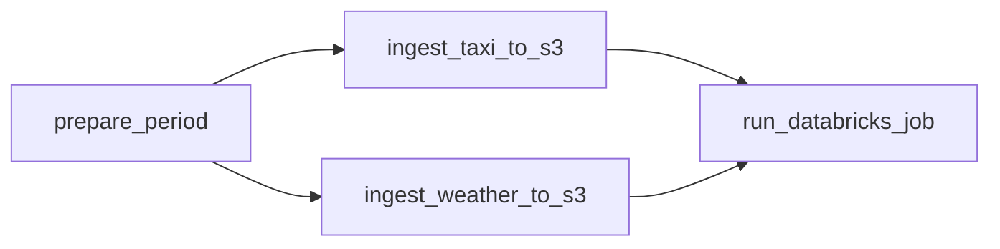
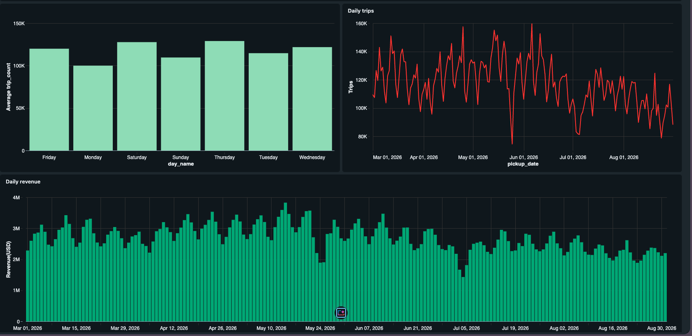
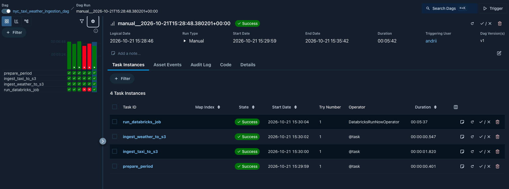
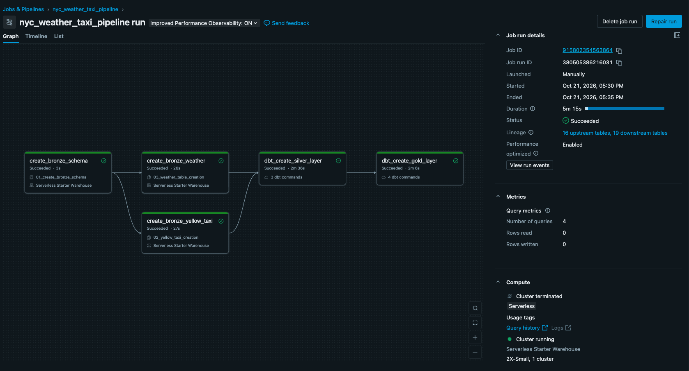

# NYC Taxi & Weather Analytics Pipeline

An end-to-end batch data engineering project combining NYC yellow taxi trips with hourly weather data.

The pipeline downloads and validates monthly source data, stores raw files in Amazon S3, loads Bronze tables in Databricks, transforms data with dbt, and refreshes a Databricks AI/BI dashboard.

Apache Airflow runs on an AWS EC2 instance and orchestrates the workflow.

## Architecture



## Project Goals

- Build a monthly cloud data pipeline with parameterized ingestion.
- Combine taxi trips with hourly weather observations.
- Separate raw ingestion, data cleaning, dimensional modeling, and reporting.
- Validate data before and after transformation.
- Support repeatable processing of an already loaded month.
- Automate dashboard refresh after successful data processing.

## Technology Stack

| Component | Technology |
|---|---|
| Source ingestion | Python, Requests, pandas, PyArrow |
| AWS integration | Boto3 |
| Raw storage | Amazon S3 |
| Orchestration | Apache Airflow 3.3.2 |
| Airflow deployment | Docker Compose on AWS EC2 |
| Airflow execution | CeleryExecutor, Redis, PostgreSQL |
| Data platform | Databricks and Delta Lake |
| Transformations | dbt Core with the Databricks adapter |
| Analytics | Databricks AI/BI dashboards |
| Local dependency management | uv |
| Version control | Git |

Transformations are implemented in SQL.

## Data Sources

### NYC Yellow Taxi Trips

Monthly Parquet files published by the NYC Taxi and Limousine Commission.

Source:

https://www.nyc.gov/site/tlc/about/tlc-trip-record-data.page

The ingestion process constructs a download URL from the requested year and month.

### Historical Weather

Hourly weather data retrieved from the Open-Meteo Historical Weather API.

Source:

https://open-meteo.com/en/docs/historical-weather-api

Configuration:

- Location: New York City
- Latitude: `40.7128`
- Longitude: `-74.0060`
- Time zone: `America/New_York`
- Variables:
  - `temperature_2m`
  - `precipitation`
  - `weather_code`

Weather observations represent the configured NYC location, not separate measurements for every taxi zone.

## Repository Structure

```text
.
├── airflow/
│   ├── .env.example
│   ├── Dockerfile
│   ├── docker-compose.yaml
│   ├── requirements.txt
│   └── dags/
│       └── nyc_taxi_weather_ingestion.py
├── ingestion/
│   ├── config.py
│   ├── run_ingestion.py
│   ├── ingest_yellow_NYC_to_s3.py
│   ├── ingest_hourly_weather_s3.py
│   ├── validate_fetched_data.py
│   └── databricks/
│       ├── bronze/
│       │   ├── 01_create_bronze_schema.sql
│       │   ├── 02_load_bronze_yellow_taxi.sql
│       │   └── 03_load_bronze_weather.sql
│       └── jobs/
│           └── nyc_taxi_weather_pipeline.json
├── nyc_taxi_weather_pipeline/
│   ├── dbt_project.yml
│   ├── packages.yml
│   ├── macros/
│   ├── models/
│   │   ├── source/
│   │   ├── silver/
│   │   └── gold/
│   │       └── marts/
│   ├── seeds/
│   └── tests/
├── docs/
│   └── data_problems.txt
├── pyproject.toml
├── uv.lock
└── README.md
```

## Storage Layout

Taxi files are organized by data year and month:

```text
s3://<bucket>/bronze/taxi/yellow/
    year=YYYY/
        month=MM/
            yellow_tripdata_YYYY-MM.parquet
```

Weather responses are organized by location and requested date range:

```text
s3://<bucket>/bronze/weather/location=nyc/
    start_date=YYYY-MM-DD/
        end_date=YYYY-MM-DD/
            response.json
```

## Data Layers

### Bronze

Databricks SQL scripts load raw S3 files into Bronze tables using `COPY INTO`.

The scripts are stored in:

```text
ingestion/databricks/bronze/
```

### Silver

Silver models clean and standardize source records:

- `silver_yellow_taxi`
- `silver_weather_hourly`

The project includes handling and validation for issues such as:

- Missing taxi attributes.
- Pickup timestamps outside the intended source period.
- Negative and zero monetary values.
- Weather fields and weather-code validity.

The exact transformation rules are defined in the SQL models.

### Gold

The Gold layer contains an enriched taxi-weather OBT and a dimensional model.

| Model | Purpose |
|---|---|
| `gold_obt_taxi_weather` | Taxi records enriched with weather and derived attributes |
| `gold_fact_yellow_taxi_trips` | Trip-level fact table |
| `gold_dim_calendar` | Calendar attributes |
| `gold_dim_payment_type` | Payment-code reference data |
| `gold_dim_taxi_zone_lookup` | Taxi-zone reference data |
| `gold_dim_vendor` | Vendor reference data |
| `gold_dim_weather_code` | Weather-code reference data |

The fact table represents one row per modeled taxi trip.

### Analytical Marts

| Model | Analytical area |
|---|---|
| `mart_daily_revenue` | Daily trip and revenue metrics |
| `mart_hourly_demand` | Hourly trip activity |
| `mart_trips_by_weather` | Trip metrics grouped by weather |
| `mart_zone_conditions_revenue` | Zone, conditions, and revenue analysis |

## Airflow Orchestration

DAG ID:

```text
nyc_taxi_weather_ingestion_dag
```

Task dependencies:



### Execution Behavior

- Taxi and weather ingestion run in parallel.
- Downloaded files are validated before upload.
- Airflow ingestion uses temporary directories.
- Databricks starts only after both ingestion tasks succeed.
- Airflow passes `year` and `month` to the Databricks job.
- Airflow waits for the Databricks job to finish.
- Only one DAG run is active at a time.

### Schedule and Data Lag

Schedule:

```text
0 6 5 * *
```

The DAG is scheduled for the fifth day of each month at `06:00 UTC`.

Automatic period selection applies a two-calendar-month lag. This is the project's ingestion policy to allow time for monthly taxi data availability.

Example:

```text
Scheduled execution: November 5, 2026
Target data month:   September 2026
```

Airflow UI times may differ depending on the selected display time zone.

### Manual Runs

Provide both parameters:

```json
{
  "year": 2026,
  "month": 8
}
```

Alternatively, leave both unset to use automatic period selection.

The DAG rejects:

- A year without a month, or a month without a year.
- Months newer than the allowed two-calendar-month lag.

## Databricks Workflow

The processing workflow loads Bronze data, runs dbt transformations and tests, and refreshes the published dashboard.

Logical sequence:

```text
Bronze loading
    → Silver transformations and tests
    → Gold / mart transformations and tests
    → Dashboard refresh
```

The repository includes a Databricks job export:

```text
ingestion/databricks/jobs/nyc_taxi_weather_pipeline.json
```

Workspace-specific settings, paths, compute, credentials, and permissions must be configured for the target environment.

The dashboard refresh task runs after the required upstream tasks succeed.

## Data Quality

### Ingestion Validation

The ingestion code validates taxi and weather files before uploading them to S3.

Taxi validation receives a required-column set including timestamps, locations, distances, payment information, and fare components.

Weather validation receives the requested date range and required hourly variables.

### dbt Tests

The project includes:

- Required-field checks.
- Unique-key checks.
- Accepted-value checks.
- Fact-to-dimension relationship checks.
- Non-negative-value checks.
- Calendar range checks.
- Custom monetary and trip-duration checks.
- A Silver-to-Gold OBT row-count reconciliation.

Custom tests include:

```text
gold_rows_count_validation.sql
total_amount_validation.sql
trip_duration_validation.sql
```

The row-count reconciliation verifies that enriching Silver taxi records does not change the total number of rows in the Gold OBT.

### Source Issues and Warnings

Source data can contain missing fields, out-of-period timestamps, and non-positive monetary values.

Payment code `5` is represented as `Unknown` in the project's payment-type handling.

A previous run produced a warning from `total_amount_validation`. Its business interpretation remains a documented follow-up until investigated and resolved or explicitly accepted.

The existence of a test in the repository does not imply that every job selector runs it. Cross-layer tests must be included in the final validation stage.

## Dashboard

The current dashboard page focuses on revenue and trip activity.

Visualizations include:

- Total revenue.
- Total trips.
- Daily revenue.
- Daily trips.
- Average daily trips by weekday.
- An interactive pickup-date range filter.

Metric definitions follow the underlying mart SQL. Revenue should not be interpreted as profit.



Dashboard refresh is integrated into the Databricks job. After new data reaches the marts, the refresh task updates the published dashboard results.

A fixed date filter can still limit the period visible to the viewer.

## Local Setup

### Prerequisites

- Python 3.12 or later.
- uv.
- An AWS account and an S3 bucket.
- AWS credentials or an appropriate IAM role.
- A configured Databricks workspace for downstream processing.
- Docker Engine and Docker Compose for the Airflow deployment.

### Install Dependencies

From the repository root:

```bash
uv sync
```

### Configure Local Ingestion

Create a root `.env` file using `.env.example`.

Required configuration includes:

```dotenv
S3_BUCKET=your-s3-bucket-name
DATA_DIR=data
AWS_DEFAULT_REGION=your-aws-region
```

AWS authentication is configured separately. Do not commit AWS credentials.

`S3_BUCKET` is required by the configuration module even when running a local download without S3 upload.

### Download and Validate a Month

Run from the repository root:

```bash
uv run python -m ingestion.run_ingestion \
  --year 2026 \
  --month 8
```

### Download, Validate, and Upload to S3

```bash
uv run python -m ingestion.run_ingestion \
  --year 2026 \
  --month 8 \
  --upload-s3
```

After a successful upload, local source files are removed unless `--keep-local` is provided:

```bash
uv run python -m ingestion.run_ingestion \
  --year 2026 \
  --month 8 \
  --upload-s3 \
  --keep-local
```

## Airflow Setup

### Configuration

From the repository root:

```bash
cd airflow
cp .env.example .env
```

Set the required configuration before starting the containers:

- Airflow Fernet key.
- Airflow API JWT secret.
- Initial administrator credentials.
- S3 bucket and AWS region.
- Databricks job ID.
- The `databricks_default` connection.
- Container paths and host file ownership settings.

On EC2, AWS access uses the attached IAM role.

The Airflow API server is bound to `127.0.0.1:8080` on the host and is accessed through an SSH tunnel rather than a publicly exposed web port.

### Build and Initialize

```bash
sudo docker compose --env-file .env build
sudo docker compose --env-file .env up airflow-init
```

### Start Services

After successful initialization:

```bash
sudo docker compose --env-file .env up -d
sudo docker compose --env-file .env ps -a
```

### Inspect Logs

```bash
sudo docker compose --env-file .env logs \
  --tail=100 airflow-scheduler airflow-worker
```

### Metadata Persistence

PostgreSQL stores Airflow metadata in a named Docker volume.

This supports metadata persistence across container restarts, but it is not a backup strategy and does not protect against loss of the underlying EC2 storage.

## dbt Development

The dbt project is located in:

```text
nyc_taxi_weather_pipeline/
```

For local execution, configure a dbt profile named:

```text
nyc_taxi_weather_pipeline
```

Do not commit a credentials-bearing `profiles.yml`.

Example commands:

```bash
cd nyc_taxi_weather_pipeline

uv run dbt deps
uv run dbt debug
uv run dbt seed

uv run dbt run --select path:models/silver
uv run dbt test \
  --select path:models/silver \
  --indirect-selection cautious

uv run dbt run --select path:models/gold

# Full-project validation, including cross-layer tests:
uv run dbt test
```

Project defaults materialize Silver and Gold models as tables. Individual model configurations can override project defaults.

## Verified Scenarios

The following scenarios were completed during development:

- End-to-end execution from Airflow through S3 and Databricks.
- Verification of August 2026 output data.
- Reprocessing the same month without unexpected duplicate growth in the checked outputs.
- Schedule and UI time-zone verification.
- EC2 reboot with automatic restart of the main containers.
- Preservation of Airflow run history and task logs after reboot.
- Successful execution of the dashboard refresh task.

These checks cover the tested environment and periods, not every possible failure or source-data condition.





## Security and Deployment Notes

- Secrets are supplied through local configuration, not committed to Git.
- EC2 accesses AWS through an IAM role.
- Airflow is accessed through an SSH tunnel.
- AWS resources were provisioned manually.
- The Docker Compose deployment is a single-host portfolio environment, not a highly available production platform.
- Private keys, tokens, `.env` files, and local datasets must remain outside version control.

## Limitations

- Weather data comes from one configured NYC location.
- Weather comparisons describe associations, not causal effects.
- Dashboard interpretation depends on model filters, metric definitions, and date coverage.
- The environment does not provide high availability.
- Infrastructure provisioning is not currently managed by Terraform.
- The monetary validation warning requires further investigation.
- Deployment to another account requires environment-specific AWS and Databricks configuration.

## Future Improvements

- Manage AWS infrastructure with Terraform.
- Automate environment provisioning and application deployment.
- Add alerting and an explicit metadata backup strategy.
- Expand weather and zone-focused dashboard pages.
- Add automated CI checks for the Python and dbt projects.

## Author

Andrii Korotkov